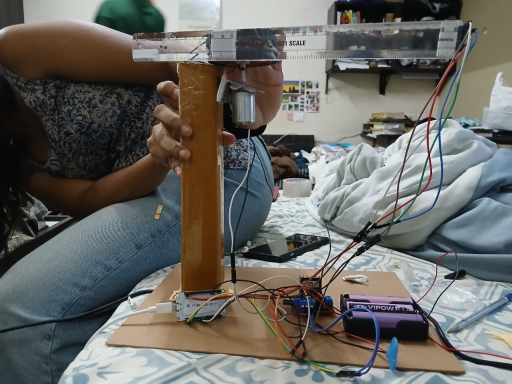
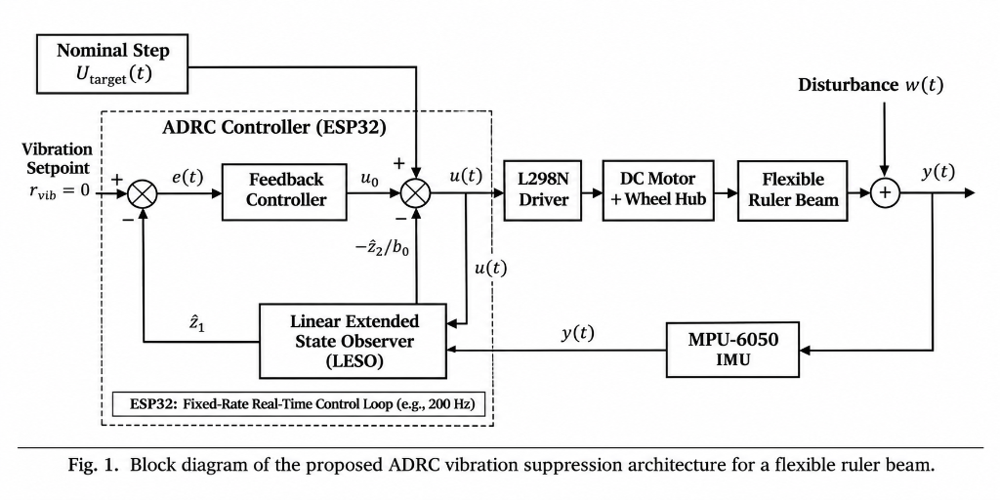

# Real-Time Vibration Suppression of a Flexible Beam Using Active Disturbance Rejection Control (ADRC)

[](https://www.espressif.com/)
[](https://www.arduino.cc/)
[]()
[-orange.svg)]()
[](LICENSE)

An embedded control systems implementation of **Linear Active Disturbance Rejection Control (LADRC)** on an **ESP32** microcontroller to achieve real-time vibration suppression and rapid oscillation damping in an underdamped flexible cantilever beam driven by a 12V DC motor.

---

## 📽️ Video Demonstration

Watch the real-time physical testbed comparison between **Uncontrolled Mode 0** and **Active ADRC Mode 1**:

🔗 **[Click here to watch the Experimental Video Demonstration (Google Drive)](https://drive.google.com/file/d/1C9Qzz4ieF12GfXA0XHlePEaRpACWUpzA/view?usp=sharing)**

---

## 📸 Hardware Testbed & System Architecture

### Physical Experimental Apparatus
The testbed features an elevated vertical support frame, a 12V brushed DC motor with a circular wheel hub, a 30 cm flexible polystyrene ruler acting as the cantilever link, a tip-mounted MPU-6050 accelerometer, an L298N motor driver, and an isolated 3S Li-ion battery pack.

<p align="center">
  
</p>

### ADRC Closed-Loop Control Architecture
Structural elasticity, higher-order modal vibrations, aerodynamic resistance, and motor friction are lumped into an unmeasured **Total Disturbance** state $f(t)$. A 2nd-order **Linear Extended State Observer (LESO)** in the acceleration manifold reconstructs $f(t)$ in real time to cancel it dynamically at the actuator root.

<p align="center">
  
</p>

---

## 💡 Key Contributions & Novelty

1. **Acceleration-Domain LESO Formulation**:
   Standard ADRC observers rely on position feedback, requiring numerical differentiation of noisy accelerometer readings. Here, the LESO is formulated directly within the **acceleration manifold**, completely avoiding derivative noise amplification, phase distortion, and actuator chatter.
2. **Model-Free Control on Compliant Consumer Components**:
   Rather than requiring expensive laser vibrometers, high-resolution optical encoders, or rigid machined alloys, this framework achieves fast oscillation damping on everyday compliant materials (polystyrene ruler on a plastic wheel hub).
3. **Deterministic 200 Hz Discrete Loop on ESP32**:
   Forward Euler state integration, high-speed 400 kHz I2C sensor acquisition, dynamic baseline tare filtering, and PWM actuation execute deterministically every $5\text{ ms}$ on low-cost silicon without external DSP hardware.

---

## ⚙️ Hardware Components & Bill of Materials (BOM)

| Component | Part / Model | Purpose / Specification |
| :--- | :--- | :--- |
| **Microcontroller** | ESP32-WROOM-32 DevKit | Dual-Core 240 MHz, 400 kHz I2C master, PWM generator |
| **Inertial Sensor** | InvenSense MPU-6050 | 6-DOF IMU, 16-bit ADC, $\pm 2g$ transverse range ($16,384\text{ LSB}/g$) |
| **Motor Driver** | L298N Dual H-Bridge | Bidirectional PWM motor driver, ENA hardware jumper ON |
| **Actuator** | 12V Brushed DC Motor | Planetary geared motor with circular plastic wheel hub |
| **Flexible Link** | 30 cm Polystyrene Scale | Dimensions: $300 \times 28 \times 1.2\text{ mm}$ (Nataraj 621) |
| **Power Supply** | 3S 18650 Li-ion Battery | $11.1\text{ V}$ nominal, $12.6\text{ V}$ peak, high-current motor supply |
| **Base & Frame** | Elevated Cardboard Pillar | $320\text{ mm}$ height, ground-isolated foundation |

---

## 🔌 Pinout & Wiring Table

| Component Pin | ESP32 GPIO | Function |
| :--- | :--- | :--- |
| **MPU-6050 SDA** | `GPIO 21` | I2C Serial Data (Fast-Mode 400 kHz) |
| **MPU-6050 SCL** | `GPIO 22` | I2C Serial Clock (Fast-Mode 400 kHz) |
| **MPU-6050 VCC / GND** | `3V3` / `GND` | Logic power and common ground |
| **L298N IN1** | `GPIO 25` | Forward PWM drive & counter-torque modulation |
| **L298N IN2** | `GPIO 26` | Direction ground (held `LOW` for forward) |
| **L298N ENA** | Jumper **ON** | Hardware enable tied HIGH (5V) |
| **L298N +12V / GND** | 3S Battery `+` / `GND` | Motor power & common ground |

> **Note:** Always ensure the ESP32 ground, L298N ground, and battery negative terminal are connected together.

---

## 📐 Mathematical Formulation

### 1. Plant Canonical Form
Under fundamental modal transformation, tip vibration acceleration $y(t) = \ddot{w}(L,t)$ is governed by:

$$\dot{y}(t) = f + b_0 u(t)$$

where $b_0$ is the nominal actuator gain and $f$ represents the **Total Disturbance**:

$$f = -\frac{c}{m}\dot{y}(t) - \frac{k}{m}y(t) + \frac{d_{\text{ext}}(t)}{m} + (b - b_0)u(t)$$

### 2. Linear Extended State Observer (LESO)
Using Gao's bandwidth parameterization ($\omega_o = 12.0\text{ rad/s}$):

$$\dot{z}_1 = z_2 - \beta_1(z_1 - y), \quad \beta_1 = 2\omega_o = 24.0$$
$$\dot{z}_2 = -\beta_2(z_1 - y), \quad \beta_2 = \omega_o^2 = 144.0$$

### 3. Active Disturbance Cancellation Law
$$u_{\text{ADRC}}(t) = \frac{-\omega_c z_1(t) - z_2(t)}{b_0}$$

---

## 💻 Direct Math-to-Code Mapping (ESP32 C++)

```cpp
// 1. Observer tracking error between estimated state z1 and sensor y:
float e = z1 - vib;

// 2. Discrete Forward Euler observer updates (Ts = 0.005 s):
z1 += Ts * (z2 - 24.0 * e);   // State z1 tracks vibration
z2 += Ts * (-144.0 * e);      // State z2 reconstructs Total Disturbance

// 3. ADRC disturbance cancellation law:
int u_adrc = constrain((int)(-50.0 * z1 - 3.0 * z2), -35, 35);

// 4. Superimpose onto nominal forward step:
cmd = constrain(TARGET_PWM + u_adrc, 180, 255);
setMotorForward(cmd);
```

---

## 🚀 Getting Started

### Prerequisites
* [Arduino IDE](https://www.arduino.cc/en/software) or [VS Code + PlatformIO](https://platformio.org/)
* ESP32 Board Package installed via Arduino Board Manager:
  ```
  https://raw.githubusercontent.com/espressif/arduino-esp32/gh-pages/package_esp32_index.json
  ```

### Flashing the Firmware
1. Open [`firmware/esp32_adrc_vibration/esp32_adrc_vibration.ino`](firmware/esp32_adrc_vibration/esp32_adrc_vibration.ino) in Arduino IDE.
2. Select your board: **Tools > Board > ESP32 Arduino > ESP32 Dev Module**.
3. Select your serial port under **Tools > Port**.
4. Click **Upload**.

### Operating the System
1. Open the **Serial Monitor** or **Serial Plotter** at `115200` baud.
2. The firmware automatically runs a 40-sample baseline gravity tare calibration.
3. Send **`0`** via serial: Executes an **Uncontrolled Baseline Step** (observe large whipping & sustained ringing).
4. Send **`1`** via serial: Executes an **ADRC Active Step** (observe rapid damping and smooth settling).

---

## 📊 Experimental Results

* **Structural Identification (Pluck Test)**:
  * Natural Frequency: $f_n \approx 7.0\text{ Hz}$ ($\omega_n \approx 44.0\text{ rad/s}$)
  * Material Damping Ratio: $\zeta \approx 0.05$ (highly underdamped)
* **Mode 0 (Uncontrolled Baseline)**:
  * Abrupt motor start-stop triggers violent initial whipping followed by residual harmonic oscillations persisting for $> 1.2\text{ seconds}$.
* **Mode 1 (LADRC Active)**:
  * The LESO tracks the dynamic deflection forces within milliseconds and injects active counter-torque at the wheel hub, substantially reducing the initial whip amplitude and rapidly extinguishing residual oscillations.

---

## 📄 Research Paper & IEEE Citation

The complete LaTeX manuscript is available in [`paper/ieee_adrc_paper.tex`](paper/ieee_adrc_paper.tex).

```bibtex
@inproceedings{juban2026adrc,
  title={Real-Time Vibration Suppression of a Flexible Beam Using Active Disturbance Rejection Control (ADRC)},
  author={Juban, Niya Rachel and Swathi, C. P. and Yarramsetti, Aparajita and Devarmani, Disha},
  booktitle={IEEE Conference Proceedings},
  year={2026},
  organization={Vellore Institute of Technology, Vellore, India}
}
```

---

## 👥 Authors

* **Niya Rachel Juban** - *Dept. of Electronics & Communication Eng., VIT Vellore* - [niya.racheljuban2024@vitstudent.ac.in](mailto:niya.racheljuban2024@vitstudent.ac.in)
* **Swathi C P** - *Dept. of Electronics & Communication Eng., VIT Vellore* - [swathi.cp2024@vitstudent.ac.in](mailto:swathi.cp2024@vitstudent.ac.in)
* **Aparajita Yarramsetti** - *Dept. of Electronics & Communication Eng., VIT Vellore* - [aparajita.2024@vitstudent.ac.in](mailto:aparajita.2024@vitstudent.ac.in)
* **Disha Devarmani** - *Dept. of Electronics & Communication Eng., VIT Vellore* - [disha.devarmani2024@vitstudent.ac.in](mailto:disha.devarmani2024@vitstudent.ac.in)

---

## 📜 License
This project is licensed under the MIT License - see the [LICENSE](LICENSE) file for details.
